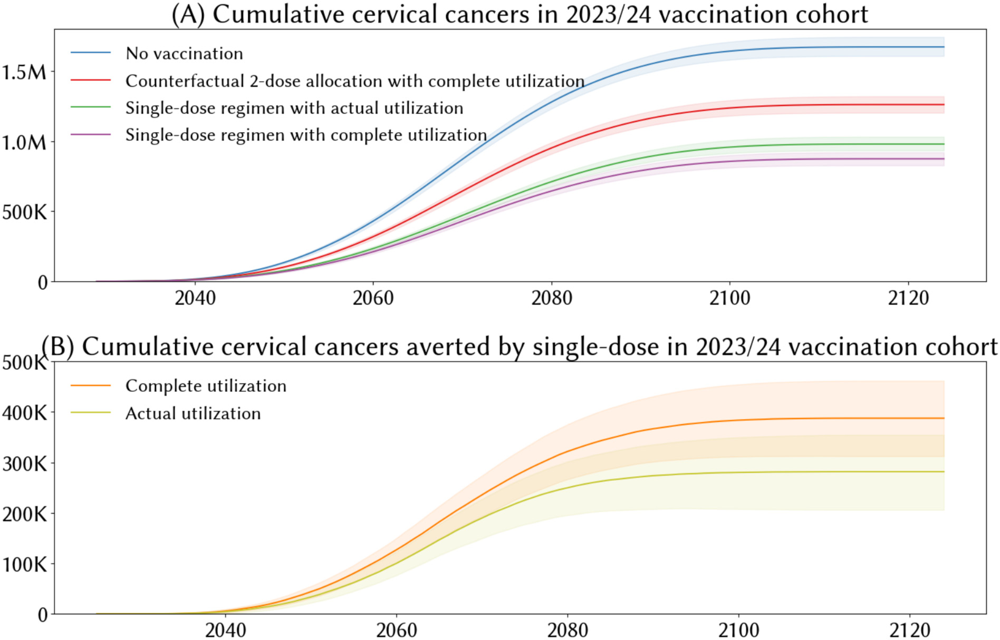

> **TL;DR.** HPV causes almost all cervical cancers, and the vaccines that prevent it are highly effective. In 2022 the WHO endorsed a single-dose schedule, which lets the same supply protect twice as many girls. By the end of 2024, nineteen Gavi-supported countries had switched. Across sixteen of those countries we estimate single-dose schedules reached 18.5M additional girls and will prevent at least 297,000 future cervical cancers. The "at least" matters: our counterfactual generously assumes every country would have introduced HPV vaccination anyway on a two-dose schedule.

**Key numbers**
- Additional girls reached due to single-dose adoption: 18.5M (actual utilization) or 23.3M (complete utilization of all shipped doses)
- Future cervical cancers averted: 297,000 (range 222,000 to 369,000) at actual utilization, 370,000 (356,000 to 376,000) at complete utilization
- Number needed to vaccinate per cancer prevented: around 63, consistent with published estimates of 78 to 381
- Countries modelled: 16 of 19 Gavi single-dose adopters in 2023 and 2024, covering 99.9% of doses
- Ethiopia, Nigeria, and Bangladesh together account for around 262,000 of the averted cancers

**Source.** Stuart R, Theopold N, Miall N, Kobayashi E, Vernam S, Taskin T, Dull PM. (2026). *The role of HPV single-dose vaccination in expanding access in GAVI-supported countries during a period of supply constraints*. Vaccine. [DOI](https://doi.org/10.1016/j.vaccine.2025.128187).

---

## Motivation

HPV vaccines have been available since 2007. The science behind them has only got stronger since, culminating in the WHO's 2022 endorsement of a single-dose schedule as offering comparable protection to multi-dose regimens. Despite all of that, the access gap is huge. By the end of 2024 only 50% of low-income countries had introduced HPV vaccination at all, against 98% of high-income countries. The proportion of lower- and middle-income countries (LMICs) with HPV programs is better (85%), but weighted by population, more than half of LMIC residents still had no HPV vaccine access at the end of 2024. India's 2026 introduction will move that number significantly, but it sits outside the period we studied.

In the context of the WHO endorsement and the rapid adoption of single-dose schedules across LMICs, this study attempted to quantify what the policy change had actually bought in real-world settings: how many additional girls were reached, and how many future cervical cancers were prevented.

## What we did

[HPVsim](https://github.com/starsim/hpvsim) is an agent-based HPV transmission and cervical disease progression model built on the [Starsim](https://starsim.org) platform. We built 16 country-specific HPVsim models for this study, one for each of the Gavi single-dose adopters in 2023 and 2024 that was large enough to model individually. Each was populated with context-specific demographic, behavioral, and programmatic data, then calibrated to GLOBOCAN cervical cancer incidence using a hyper-parameter optimization algorithm.

We compared four scenarios per country: no vaccination at all, a two-dose counterfactual with full utilization, single-dose with full utilization, and single-dose with the coverage actually reported. We ran 20 random seeds per scenario per country, giving us 10 to 90 percentile uncertainty ranges. UNICEF shipment data (51.4M one-dose and 10.8M two-dose doses shipped to Gavi countries in 2023 and 2024, with 5% or 10% wastage by vaccine profile) anchored the supply side.

## What we found

Around 60 million doses were shipped to countries supported by Gavi to purchase HPV vaccines over 2023 and 2024. Under a 2-dose counterfactual, this would have protected 30 million girls against HPV; thanks to the 19 countries that shifted to single dose, an additional 23.3M girls were reached. 

The model estimates up to 370,000 future cervical cancer cases averted across the cohort eligible for vaccination in 2023 and 2024, if every shipped dose had reached a girl in the target age band. At the actually reported coverage levels the estimate is 297,000.

Ethiopia, Nigeria, and Bangladesh together account for around 262,000 of the averted cancers, over half the total. The drivers are population size, cervical-cancer burden, and milestone multi-age cohort campaigns, such as the campaign efforts in Ethiopia that protected over 7 million girls aged 9 to 14 at launch.

## A lower bound, not an upper bound

We assumed every country in the analysis would have introduced HPV vaccination anyway, just on a two-dose schedule. In reality, several of these countries might never have introduced HPV vaccination at all without the single-dose option to stretch the available supply. So our 297,000 and 370,000 averted-cancer figures are not the upper bound of what the 2022 WHO endorsement made possible: they are the lower bound. The true attributable impact is plausibly larger. 

## Where the conversation goes next

For a long time, the supply-side picture was a binding constraint for scaling up HPV vaccination. In the single-dose era, and as more manufacturers have appeared, the questions are evolving. With sufficient doses, it is feasible to vaccinate boys, to run aggressive catch-up campaigns, or to devise novel methods for reaching marginalized and neglected populations. HPV modeling research is now shifting to the impact and relative priority of expanded vaccine access strategies. This work, along with critically important studies on barriers to vaccine delivery and uptake, is essential to ensure that the full benefits of the single-dose recommendation are attained. 

